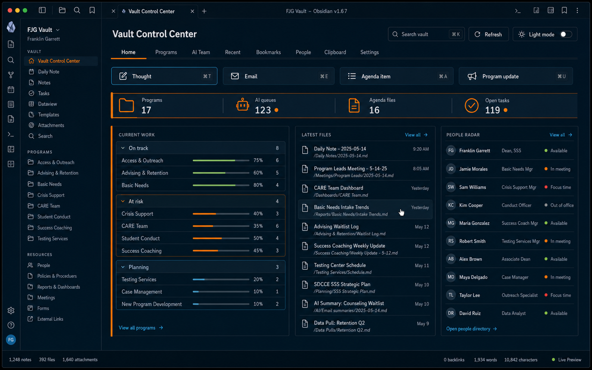

# Vault Control Center

Vault Control Center is a native Obsidian dashboard for operating a structured vault. It replaces a static HTML Viewer/local-server workflow with a live `ItemView`: files, folders, active HTML home pages, queues, bookmarks, people, task workspaces, capture actions, automations, and templates all work through Obsidian itself.



> The image above is an illustrative design concept. The plugin renders your own live vault data.

## What it includes

The dashboard keeps eleven views in one consistent throwback navy, gold, orange, royal-blue, and warm-cream interface:

| View | Purpose |
| --- | --- |
| Home | Talk to Vault, capture actions, live signals, current programs, recent files, people, and local FJG Task Manager status |
| Areas | The complete safe folder tree, including empty folders, plus every supported file under the configured Areas source, with a collapsible root rail, recursive drill-down, route-wide file search, breadcrumbs, and in-dashboard previews |
| Programs | Program folders, activity groups, a collapsible root rail, recursive subfolder drill-down, route-wide file search, breadcrumbs, and in-dashboard previews |
| HTML | HTML Viewer’s live, filtered catalog with compact mobile thumbnail cards. Saved local previews appear where available. |
| AI Team | Four configurable operational queues; Owner and Team inboxes use complete direct-file counts and lists |
| Automations | Mail Cache Bridge Inbox sync status and **Sync Now** on the Mac running the bridge |
| Recent | Searchable, vault-wide Obsidian file-open history with category filters |
| Bookmarks | Filtered Obsidian bookmarks; vault targets preview inside the dashboard and HTTP(S) links open externally |
| People | Agenda files, recency, and contact-list access |
| Clipboard | Editable, copyable, resettable templates |
| Settings | Theme, source health, privacy boundary, and native plugin settings |

Additional features:

- Native ribbon icon and command-palette actions
- **Home → Talk to Vault** opens the existing voice experience in FJG File Focus Duo, or FJG Objective Manager if Duo is unavailable. Enable at least one of those community plugins and complete its voice setup. Vault Control Center does not manage additional credentials, capture audio, or start a separate voice session. On a wide mobile workspace, Home can return to the same still-open native note you viewed before Home so chat opens beside it. Side-by-side handoff uses File Focus Duo 0.1.20+ or Objective Manager 0.30.18+; a compact or older-provider launch still works as before.
- A visible **Copy path** action in the Areas and Programs folder browser that follows drill-down, **Up**, and breadcrumb navigation and copies the current vault-relative folder path for Obsidian Clipper
- Searchable active HTML home-page cards with title, description, category, folder, modified time, and a reusable native-tab opening flow
- Explicit **Update previews** regeneration for HTML thumbnails through macOS Quick Look; generated PNGs use stable names in a configurable vault-relative runtime folder
- **Automations → Mail Cache Bridge** shows local Inbox sync status, last sync and indexed count, and sends an explicit **Sync Now** request to the opt-in companion app on this Mac. Mobile explains where the controls are available.
- Local FJG Task Manager workspace counts and due-sorted **Do First** items, with task-note preview and a direct **Task Manager** action
- Shared preview pane across ordinary file-bearing routes; normal clicks keep the dashboard active, and Markdown notes can switch into Obsidian's native editor in place
- Near-even desktop workspace with a slightly larger right-side preview, plus an independently retractable Areas and Programs root rail for additional folder-detail and note space
- Compact **Back**, Markdown **Edit** / **Preview**, **Open in tab**, and **Hide files** / **Show files** controls that remain accessible when labels collapse in constrained panes
- **Hide files** / **Show files** can still temporarily give the read-only note nearly the full dashboard width without changing the root-rail state
- Full-pane Markdown layout plus responsive title/path controls so note text uses the available preview width without clipping at larger display scales
- Markdown, text/CSV/HTML source, JSON, image, audio, video, PDF, and Canvas-summary previews; Markdown **Edit** embeds Obsidian's real `MarkdownView` and CodeMirror editor, while **Open in tab** preserves the dashboard and reuses one separate editor tab
- Coordinated throwback dark and light themes derived from deep navy, golden yellow, orange, royal blue, and warm cream
- Optional Obsidian shell theming that is removed cleanly when disabled or unloaded
- Responsive layouts for desktop, split panes, tablets, and phones
- Live refresh after vault changes, with a manual force-refresh action
- Owner Inbox and Team Inbox treat direct safe, supported files as the active queue; nested subfolders are excluded, and queue lists are not truncated
- Recently viewed files start with Vault Control Center preview history, then use the enabled Recent Files plugin's file-open history when available and append Obsidian's native open history
- `/` to focus search while the dashboard is active, with the native search clear control
- On Areas and Programs, any nonblank query replaces drill-down with all safe files across that route whose file name or full folder path matches; synthetic **All Areas** copies are deduplicated
- In-memory file and task indexing; only a capped list of safe preview paths is retained in Obsidian workspace state so Recent remains accurate, while explicitly generated HTML thumbnails are portable vault files

## Installation

### BRAT

1. Install and enable BRAT in Obsidian.
2. Choose **Add Beta plugin**.
3. Enter `jajuangarrett-ctrl/vault-control-center`.
4. Enable **Vault Control Center** in Community plugins.

### Manual

Download `main.js`, `manifest.json`, and `styles.css` from the latest release. Place them together in `<vault>/.obsidian/plugins/vault-control-center/`, then reload Obsidian and enable the plugin.

Vault Control Center requires Obsidian 1.12.7 or newer and is not desktop-only. The HTML tab requires enabled HTML Viewer 0.2.3 or newer; otherwise it explains how to enable or update it instead of scanning for a replacement list. Quick Look thumbnail generation and Mail Cache Bridge controls require desktop Obsidian on macOS. Mail Cache Bridge must be open on the same Mac.

## First-run setup

Open **Settings → Community plugins → Vault Control Center** and configure the vault-relative paths for:

- Areas
- Programs
- Desktop preview generation roots, exact home-page allowlist, and the vault-relative thumbnail folder
- People agendas and contacts
- Tasks
- Four operational queues
- Recent-activity fallback roots

The bundled HTML defaults select 30 audited canonical launch pages. Other missing sources are reported in the dashboard instead of causing the view to fail.

Areas and Programs search does not change the selected root or nested folder. A matching file opens in the shared preview, Back returns to the same results, and **Clear search** restores the exact pre-search folder view. A route-wide empty state appears when nothing matches. Result paths wrap at desktop, split-pane, and phone widths.

When the folder browser is visible, **Copy path** copies the exact current folder without the vault name, a leading slash, or a macOS `/Users/...` prefix. The same action is available from the command palette as **Vault Control Center: Copy current dashboard folder path** while an Areas or Programs folder is active, so it can also be assigned in **Settings → Hotkeys**.

The HTML route shows only exact paths listed under **HTML home pages** that also sit inside the configured **HTML gallery roots**. The path list chooses the canonical launch page for each active dashboard or tool; the roots remain the outer safety boundary. Leaving the home-page list blank intentionally shows no cards. Hidden, archived, sensitive, inbox/queue, source/build/test, and reusable-template paths remain excluded even when listed. Metadata parsing is capped, unchanged results are cached, and reads use bounded concurrency. **Update previews** is an explicit action: on desktop macOS it asks Quick Look to regenerate the current gallery, stores the results in the configured vault-relative folder, and isolates individual failures so one bad home page does not stop the rest. Clicking a card uses the registered desktop HTML viewer in the same reusable native tab when available; mobile, a missing viewer, or an opening failure falls back to the safe in-dashboard HTML source preview.

### Mail Cache Bridge

In the native **Mail Cache Bridge** app on your Mac, enable exports and **Allow Vault Control Center**, then keep the app open. In desktop Obsidian on that same Mac, open **Vault Control Center → Automations** to see the current Inbox sync status and use **Sync Now**. The app controls Mail access, export location, schedule, and whether the request can run. A request is not a completion; check for **Sync complete**. iPhone, iPad, Windows, and Linux do not read or trigger the local bridge from Obsidian.

This tab no longer shows the scheduled processors, RAM monitor, or remote Obsidian reload. Removing those controls does not stop or reconfigure existing automations.

Recent combines three sources in viewed order: files previewed inside Vault Control Center, the optional Recent Files plugin when it is enabled in file-open mode, and Obsidian's native open history. Preview history is capped at 30 safe paths in the Obsidian workspace state; no file contents are stored. If none of these sources provides usable viewed-file history, the dashboard temporarily falls back to modified-time activity under the configured recent roots.

Capture buttons dispatch commands from companion capture plugins. Install and enable the corresponding Thought Capture, Email Capture, and Agenda Capture plugins for those buttons to work. The **All Files** tile opens the vault root instead of dispatching a capture command. Vault Control Center does not register the displayed actions as global hotkeys.

## FJG Task Manager integration

The Home task panel reads local FJG Task Manager workspace notes at `08 Tasks/Workspaces/*/task.md`. Completed and archived workspaces are excluded from the open count. The panel lists up to eight **Do First** tasks, sorted by due date, and selecting one opens its task note in the dashboard preview. The **Task Manager** action delegates to `fjg-task-manager:open-dashboard`, so the companion plugin must be installed and enabled for that button to open its dashboard.

This v0.2.0 integration does not make a taskboard network request. Legacy remote-taskboard settings are retained for compatibility but do not supply the Home task panel.

## Privacy and external-access disclosure

Vault Control Center reads the vault-relative folders and files configured in its settings plus Obsidian's bookmarks configuration file. Vault content discovery stays within the vault. On desktop macOS, the explicit HTML thumbnail action uses `/usr/bin/qlmanage` and a temporary operating-system folder; the Automations tab reads a small aggregate status from the local Mail Cache Bridge control directory and writes a one-time request only when you click **Sync Now**. It does not open Mail, read exported messages, send a network request, or write status to the vault.

Before display, the index excludes hidden/internal folders, archived paths, and names that look like passwords, API keys, secrets, credentials, tokens, or private keys. Bookmark URLs containing basic-auth credentials or obvious sensitive query keys are withheld; visible URL metadata is reduced to the origin while the original URL is retained only for opening.

Path settings, interface preferences, and clipboard templates are stored in the plugin's local settings. Live file indexes, file contents, task records, and Mail Cache Bridge status are not saved there. Obsidian workspace state may contain the currently previewed safe path, a capped safe-path preview history, and the Areas/Programs root-rail disclosure state so the dashboard survives workspace restoration. Generated HTML thumbnails are the one intentional derived-file exception: they are written to the configured vault-relative runtime folder when **Update previews** is selected.

## Replacing the legacy launcher

The native plugin and an older HTML-launcher plugin can coexist during migration. Once the native dashboard is configured and verified, disable the legacy launcher to avoid two ribbon buttons with similar names. Only the HTML tab needs the HTML Viewer plugin. No local web server is required.

## Development

The local 0.3.17 build adds **Move** beside the preview's upper-right Edit/Open in tab/Hide files controls. It uses the existing single-file destination picker; cancel leaves the item untouched, and collisions never overwrite. The icon remains accessible and at least 44 px at narrow widths. See [File review](docs/FILE_REVIEW.md).

```bash
npm ci
npm run check
```

`npm run check` runs the Vitest suite, strict TypeScript validation, and the production esbuild bundle.

## Troubleshooting

- **A source shows Missing:** confirm its vault-relative path in plugin settings, then use Refresh.
- **A capture action reports that it is not enabled:** install and enable the corresponding companion capture plugin.
- **Task counts or Do First items are missing:** confirm FJG Task Manager is creating workspace notes under `08 Tasks/Workspaces/` and that each `task.md` has a current `status` value. Completed and archived tasks are intentionally omitted from the open count, and only `do-first` tasks appear in the list.
- **The Task Manager button reports that it is not enabled:** install and enable FJG Task Manager; the local task counts and rows can still load without its command.
- **HTML cards have placeholders:** on desktop macOS, choose **Update previews**. Other devices can browse the gallery and inspect safe source previews but cannot run Quick Look.
- **Run now is disabled:** confirm the exact job is loaded locally, or enable the dedicated broker and select its client credential in Obsidian Secret Storage. Broker outages and incomplete settings disable remote controls cleanly.
- **RAM is unavailable:** the dashboard requires either a proven local executor or a fresh authenticated remote executor heartbeat.
- **BRAT cannot install or update:** confirm the GitHub release includes `main.js`, `manifest.json`, and `styles.css` and that its tag matches the manifest version.
- **The old dashboard still opens:** disable the legacy launcher after confirming the native plugin is configured.
- **Recent does not match files you just viewed:** use Refresh. Files previewed in the dashboard are placed first, followed by Recent Files and native Obsidian history; configured recent roots are used only when no viewed history is available.
- **A Markdown note opens in preview:** choose **Edit** to replace the rendered preview with Obsidian's native editor. Choose **Preview** to save pending editor changes and return to rendered Markdown.
- **A file shows “Native preview required”:** use **Open in tab** for Office documents or formats without a safe embedded renderer.
- **Open in tab keeps returning to the same editor tab:** this is intentional. The dashboard stays open while subsequent files replace the note in one reusable editor tab; closing or pinning that tab makes the next action create a fresh one.

## Design notes

The interface follows a reference-driven workflow: one stable information architecture, coordinated dark/light token sets, dense operational rows, and responsive behavior verified at both pane and viewport widths. See [the design system](docs/design/DESIGN.md) and [the fidelity ledger](tests/visual/FIDELITY.md).

## License

MIT © Franklin Garrett

Live file review: see [File review](docs/FILE_REVIEW.md) for the watched inbox and Wiki folders, recursive membership, automatic and manual refresh, and safe per-file moves.

## Mobile HTML viewing (0.3.18)

Mobile now lists every eligible synced HTML/HTM page, independently of desktop home-page curation. Pages open inside the dashboard as an in-memory document with local assets embedded, script isolation, device-local per-page storage, read-only JSON/CSV/TXT fetches inside the page folder, and relative HTML navigation. Original HTML and plugin settings are preserved. Online dependencies and server-backed apps still require their services; unsupported/missing assets produce notices. Desktop HTML discovery and opening remain unchanged. See `src/mobile-html.ts` and the synthetic browser acceptance fixture in `tests/mobile-html-browser.js`. Physical mobile verification is pending.

### BRAT delivery (0.3.19)

The 0.3.18 mobile build was local-only. Version 0.3.19 publishes the renderer as a BRAT release, recognizes native mobile apps even in desktop-style layouts, and labels the mobile preview `HTML interactive · 0.3.19`. Update this plugin through BRAT and restart Obsidian on the receiving device. The original HTML file remains unchanged.
